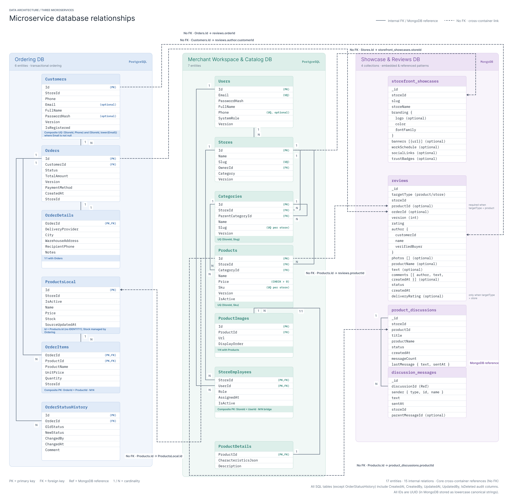

# SaaS E-Commerce Multi-Tenant Platform

## 1. Опис предметної області та Bounded Contexts
Система є мультитенантною e-commerce платформою (SaaS), яка дозволяє незалежним мерчантам створювати власні вітрини, керувати каталогом товарів, обробляти замовлення та взаємодіяти з клієнтами через систему відгуків і Q&A.

Архітектура розділена на 3 незалежні обмежені контексти за патерном **Database-per-Service**:

## Діаграма для зображення 3 БД та їх звязків між собою (повні діаграми SQL БД в docs)


1. **Ordering Context (`ordering_db` — PostgreSQL):**
   * *Відповідальність:* Транзакційне оформлення покупок, логістика, відстеження статусів (State Machine) та резервування залишків.
   * *Сутності:* `customers`, `orders`, `order_details`, `products_local`, `order_items`, `order_status_history`.

2. **Merchant Workspace & Catalog Context (`catalog_db` — PostgreSQL):**
   * *Відповідальність:* Адміністрування магазинів, персонал, ієрархічні каталоги та картки товарів (з характеристиками та медіа).
   * *Сутності:* `users`, `stores`, `categories`, `products`, `product_details`, `product_images`, `store_employees`.

3. **Showcase & Reviews Context (`showcase_db` — MongoDB):**
   * *Відповідальність:* Високонавантажене читання публічних вітрин, поліморфні відгуки з фото, гілки Q&A.
   * *Колекції:* `storefront_showcases`, `reviews`, `product_discussions`, `discussion_messages`.

---

## 2. Фізична автономність баз даних
Між трьома базами даних **повністю відсутні фізичні FOREIGN KEY**. Бази автономні й можуть масштабуватися незалежно. Інтеграція відбувається на рівні додатку через спільні UUID:
* `catalog_db.stores.id` ↔ `ordering_db.orders.store_id` ↔ `showcase_db.storefront_showcases.storeId`
* `catalog_db.products.id` ↔ `ordering_db.products_local.id` ↔ `showcase_db.reviews.productId`

**Запит для перевірки відсутності зовнішніх FK (PostgreSQL):**
```sql
SELECT tc.table_schema, tc.table_name, kcu.column_name, ccu.table_name AS referenced_table
FROM information_schema.table_constraints tc
JOIN information_schema.key_column_usage kcu ON tc.constraint_name = kcu.constraint_name
JOIN information_schema.constraint_column_usage ccu ON ccu.constraint_name = tc.constraint_name
WHERE tc.constraint_type = 'FOREIGN KEY'; 
```

## 3. Політика дублювання даних (Data Duplication Policy)

Правило: у кожного дубльованого поля є єдиний власник (Master). Копії є або **знімком** (не оновлюється), або **копією для читання** (оновлюється подіями власника, eventual consistency; механізм доставки подій реалізується в Лаб. 08). Незалежне редагування однієї копії у двох сервісах (dual write) заборонене.

### 3.1. Catalog DB → Ordering DB

| Поле | Де зберігається (Replica) | Джерело (Master) | Політика узгодженості |
| :--- | :--- | :--- | :--- |
| `name`, `price`, `is_active` | `ordering_db.products_local` | `catalog_db.products` | **Eventual Consistency:** оновлюється асинхронно через події (напр. `ProductUpdated`) процедурою `usp_sync_product`. Застарілі події ігноруються за `source_updated_at`. Дозволяє валідувати кошик без HTTP-запитів до каталогу. |
| `product_name`, `unit_price` | `ordering_db.order_items` | `catalog_db.products` (через `products_local`) | **Snapshot (історичний знімок):** фіксується транзакційно в момент покупки, ніколи не оновлюється. Захищає фінансові дані чека від змін у каталозі. |
| `store_id` | `ordering_db.customers`, `orders`, `order_items`, `products_local` | `catalog_db.stores.id` | **Логічне посилання за ID без FK:** значення незмінне, використовується як ідентифікатор тенанта. Існування магазину перевіряє прикладний код. |

### 3.2. Catalog DB → Showcase DB (MongoDB)

| Поле | Де зберігається (Replica) | Джерело (Master) | Політика узгодженості |
| :--- | :--- | :--- | :--- |
| `productName` | `showcase_db.reviews`, `product_discussions` | `catalog_db.products.name` | **Eventual Consistency:** оновлюється подією `ProductUpdated` (`updateMany` за `productId`). Денормалізація для швидкого рендерингу карток відгуків одним запитом. |
| `storeName`, `slug` | `showcase_db.storefront_showcases` | `catalog_db.stores.name`, `slug` | **Eventual Consistency:** оновлюється подією `StoreRenamed`. Відображення шапки магазину на вітрині без JOIN-ів. |
| `storeId`, `productId` | усі колекції `showcase_db` | `catalog_db.stores.id`, `products.id` | **Логічне посилання за ID без FK:** значення незмінні. |
| `sender.id`, `sender.name` (тип `Merchant`) | `showcase_db.discussion_messages` | `catalog_db.users` | **Snapshot:** фіксується на момент повідомлення, не оновлюється. |

### 3.3. Ordering DB → Showcase DB (MongoDB)

| Поле | Де зберігається (Replica) | Джерело (Master) | Політика узгодженості |
| :--- | :--- | :--- | :--- |
| `author.customerId`, `orderId` | `showcase_db.reviews` | `ordering_db.customers.id`, `orders.id` | **Логічне посилання за ID без FK:** значення незмінні, існування замовлення перевіряє прикладний код при створенні відгуку. |
| `author.name` | `showcase_db.reviews` | `ordering_db.customers.full_name` | **Snapshot:** фіксується на момент відгуку, не оновлюється. |
| `author.verifiedBuyer` | `showcase_db.reviews` | `ordering_db.orders.status` | **Snapshot (обчислюється один раз):** `true`, якщо на момент створення відгуку замовлення має статус `Paid` або `Shipped`. Надалі не змінюється. |
| `sender.id`, `sender.name` (тип `Customer`) | `showcase_db.discussion_messages` | `ordering_db.customers` | **Snapshot:** фіксується на момент повідомлення, не оновлюється. |


## Інструкція з розгортання баз даних

Усі скрипти є ідемпотентними, тому повторний запуск не створює дублікатів і не призводить до помилок.

Розгортання всіх трьох баз даних виконується послідовно: створення баз даних, застосування DDL-схем, реєстрація процедур, наповнення початковими даними (seed) та ініціалізація MongoDB-колекцій з валідацією схем.

```bash
# 1. Ordering DB (PostgreSQL)
psql -U postgres -c "CREATE DATABASE ordering_db;"
psql -U postgres -d ordering_db -f db/p1/schema.sql
psql -U postgres -d ordering_db -f db/p1/procedures.sql
psql -U postgres -d ordering_db -f db/p1/seed.sql

# 2. Catalog DB (PostgreSQL)
psql -U postgres -c "CREATE DATABASE catalog_db;"
psql -U postgres -d catalog_db -f db/p2/schema.sql
psql -U postgres -d catalog_db -f db/p2/seed.sql

# 3. Showcase DB (MongoDB)
mongosh "mongodb://localhost:27017/showcase_db" db/p3/collections.js
mongosh "mongodb://localhost:27017/showcase_db" db/p3/seed.js
```

### Приклад тесту перевірки неприпустимого переходу (State Machine):
Спроба відвантажити неоплачене замовлення викличе керовану помилку ORD04:
```sql
psql -U postgres -d ordering_db -c "CALL
usp_change_order_status('019273c8-0004-7000-8000-000000000004',
'11111111-1111-1111-1111-111111111111', 1, 'Shipped', 'test_user',
'test');"
```

```diff
- ERROR:  Cannot ship unpaid prepaid order 019273c8-0004-7000-8000-000000000004
- CONTEXT:  PL/pgSQL function usp_change_order_status(uuid,uuid,integer,character varying,character varying,character varying) line 33 at RAISE
```


---

## 4. Тришарова архітектура на базі ADO.NET та Dapper (.NET 10 & .NET Aspire)

### 4.1. Архітектура та схема рішення (Project Structure)
Мікросервіс **`Orders`** реалізовано як автономну вертикаль (Vertical Slice) з односпрямованим потоком залежностей `Api ➔ Bll ➔ Dal ➔ Domain`:
* **`Services/Orders/Orders.Domain`**: сутності предметної області (`Customer`, `Order`, `OrderItem`, `OrderDetails`, `ProductLocal`, `OrderStatusHistory`) та доменні винятки (`NotFoundException`, `BusinessConflictException`, `ValidationException`).
* **`Services/Orders/Orders.Dal`**: шар доступу до даних. Інкапсулює всі SQL-запити:
  * Чистий ADO.NET (`CustomerRepository` на базі `NpgsqlConnection`/`NpgsqlCommand`);
  * Dapper репозиторії з multi-mapping та викликами збережених процедур (`OrderRepository`, `ProductRepository`);
  * `UnitOfWork` для координації транзакцій (`BeginTransactionAsync`, `CommitAsync`, `RollbackAsync`);
  * Централізований мапінг винятків PostgreSQL (`PostgresExceptionMapper`).
* **`Services/Orders/Orders.Bll`**: шар бізнес-логіки. Включає DTO для API, централізовані профілі AutoMapper (`OrderMappingProfile`), дворівневу валідацію (DataAnnotations + стан БД) та сервіси (`OrderService`, `CustomerService`).
* **`Services/Orders/Orders.Api`**: тонкі асинхронні Web API контролери (`OrdersController`, `CustomersController`) з атрибутною маршрутизацією, `CancellationToken` та глобальним обробником помилок `DomainExceptionHandler` (RFC 7807 ProblemDetails).
* **`Platform.AppHost`**: проєкт оркестрації .NET Aspire, який зв'язує API з базою даних `OrdersDb`.

---

### 4.2. Інструкція із запуску (How to Run)

#### Варіант 1: Запуск через .NET Aspire (Рекомендовано)
Запуск оркестратора однією командою з кореня репозиторію:
```bash
dotnet run --project Platform.AppHost
```
Після старту відкривається **Aspire Dashboard** (за адресою `https://localhost:17...`), де доступні метрики, трейси, логи та посилання на Swagger UI сервісу `orders-api`.

#### Варіант 2: Автономний запуск Orders.Api
```bash
dotnet run --project Services/Orders/Orders.Api
```
Інтерактивна документація Swagger доступна за адресою:
👉 `http://localhost:5096/swagger` (або `https://localhost:7071/swagger`).

---

### 4.3. Приклади HTTP-запитів до API (curl / Postman)

#### 1. Створення клієнта (чистий ADO.NET + процедура `usp_create_customer`)
```bash
curl -X POST "http://localhost:5096/api/customers" \
  -H "Content-Type: application/json" \
  -d '{
    "storeId": "11111111-1111-1111-1111-111111111111",
    "phone": "+380501112233",
    "email": "ivan.petrenko@example.com",
    "fullName": "Іван Петренко",
    "password": "SecurePassword123!"
  }'
```
*Очікувана відповідь:* `201 Created` із заголовком `Location` та даними створеного клієнта.

#### 2. Оформлення замовлення (Dapper + процедура `usp_create_order` з резервуванням залишків)
```bash
curl -X POST "http://localhost:5096/api/orders" \
  -H "Content-Type: application/json" \
  -d '{
    "storeId": "11111111-1111-1111-1111-111111111111",
    "customerPhone": "+380501112233",
    "customerFullName": "Іван Петренко",
    "customerEmail": "ivan.petrenko@example.com",
    "deliveryProvider": "NovaPoshta",
    "city": "Київ",
    "warehouseAddress": "Відділення №15, вул. Хрещатик, 22",
    "recipientPhone": "+380501112233",
    "paymentMethod": "Prepaid",
    "items": [
      {
        "productId": "019273c8-0001-7000-8000-000000000001",
        "quantity": 2
      }
    ]
  }'
```
*Очікувана відповідь:* `201 Created` з повним агрегатом замовлення `OrderDto`.

#### 3. Підтвердження оплати (Транзакційна операція через UnitOfWork: Orders + Products)
```bash
curl -X POST "http://localhost:5096/api/orders/019273c8-0004-7000-8000-000000000004/pay?storeId=11111111-1111-1111-1111-111111111111"
```
*Очікувана відповідь:* `200 OK` (переводить замовлення `Prepaid` зі статусу `Submitted` в `Paid`).

#### 4. Обробка бізнес-конфлікту (RFC 7807 ProblemDetails 409 Conflict)
Спроба зміни статусу з конфліктом оптимістичного блокування версії (`expectedVersion = 999`):
```bash
curl -X PUT "http://localhost:5096/api/orders/019273c8-0004-7000-8000-000000000004/status" \
  -H "Content-Type: application/json" \
  -d '{
    "storeId": "11111111-1111-1111-1111-111111111111",
    "expectedVersion": 999,
    "newStatus": "Shipped",
    "changedBy": "operator"
  }'
```
*Очікувана відповідь:* `409 Conflict` у форматі ProblemDetails:
```json
{
  "type": "about:blank",
  "title": "Business Conflict",
  "status": 409,
  "detail": "Concurrency conflict for order 019273c8-0004-7000-8000-000000000004. Current version: 1, expected: 999",
  "instance": "PUT /api/orders/019273c8-0004-7000-8000-000000000004/status"
}
```