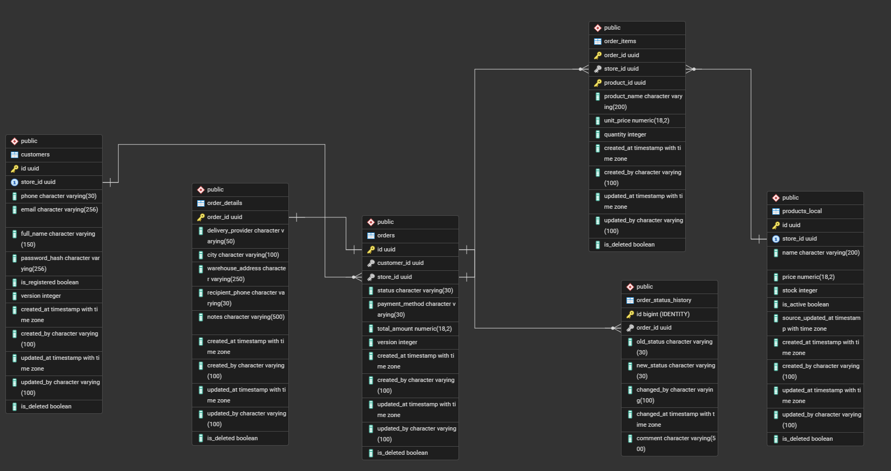
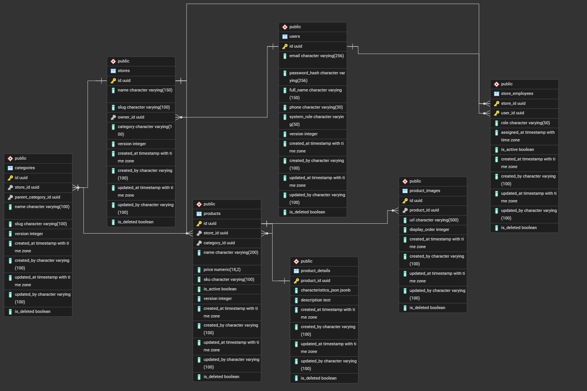

# Опис обмежених контекстів (Bounded Contexts) та Агрегатів

Наша SaaS E-Commerce платформа спроєктована на основі принципів Domain-Driven Design (DDD). Всю систему розділено на три незалежні обмежені контексти (Bounded Contexts). Кожен контекст інкапсулює власну бізнес-логіку, має незалежну схему даних та автономну базу даних.

## 1. Ordering Context (Контекст Замовлень)
**База даних:** `ordering_db` (PostgreSQL)

Цей контекст відповідає за транзакційний процес оформлення покупок, перевірку наявності товарів на складі, логістичні деталі та рух замовлення по статусах (State Machine).

**Основні агрегати та сутності:**
*   **Order (Кореневий агрегат):** Містить загальну суму, статус, метод оплати. Жорстко пов'язаний з позиціями (`order_items`) та деталями доставки (`order_details`).
*   **OrderItem (Сутність всередині агрегату):** Зберігає **історичний знімок (snapshot)** ціни та назви товару на момент покупки. Ніколи не оновлюється при змінах у каталозі, що гарантує фінансову цілісність чека.
*   **ProductsLocal (Локальна репліка):** Довідникова таблиця, яка зберігає копію необхідних даних із каталогу (ціна, залишки, статус активності) для швидкої валідації кошика та транзакційного списання залишків без синхронних HTTP-запитів до інших сервісів.
*   **OrderStatusHistory:** Забезпечує аудит усіх змін статусів замовлення.


---

## 2. Catalog & Merchant Context (Контекст Каталогу та Адміністрування)
**База даних:** `catalog_db` (PostgreSQL)

Контекст є "майстер-системою" (джерелом істини) для даних про магазини, їхніх працівників, дерева категорій та самі товари. 

**Основні агрегати та сутності:**
*   **Store (Кореневий агрегат):** Магазин конкретного мерчанта. Виступає логічним ізолятором (Tenant) — усі категорії та товари жорстко прив'язані до `store_id`.
*   **Product (Агрегат):** Базова картка товару (SKU, ціна, зв'язок з категорією).
*   **ProductDetails (Зв'язок 1:1):** Винесена таблиця для гнучких JSON-характеристик та довгого текстового опису.
*   **ProductImages (Зв'язок 1:N):** Медіафайли товару із вказаним порядком сортування (`display_order`).
*   **StoreEmployees (Зв'язок M:N):** Проміжна таблиця, яка фіксує зв'язок між користувачами платформи (`users`) та магазинами (`stores`), містить власне поле `role` (роль працівника у конкретному магазині).



---

## 3. Showcase & Reviews Context (Контекст Вітрини та Відгуків)
**База даних:** `showcase_db` (MongoDB)

Цей контекст оптимізовано для високонавантаженого читання та гнучкої структури даних. Він відповідає за публічне відображення вітрини, збір поліморфних відгуків та обговорення товарів.

**Основні колекції (Агрегати):**
*   **storefront_showcases (Патерн Вбудовування / Embedding):** Зберігає всю інформацію для рендерингу магазину (брендинг, графік, денормалізована назва) у єдиному документі, виключаючи необхідність JOIN-ів.
*   **reviews (Гібридний підхід + Поліморфізм):** Колекція містить документи різної структури. Відгук може бути на товар (`targetType: "product"`) або на магазин (`targetType: "store"`). Структура полів динамічно змінюється (наприклад, масив `photos` або `deliveryRating` присутні лише там, де вони дійсно потрібні). Відповіді адміністрації вбудовані масивом (`comments`).
*   **product_discussions та discussion_messages (Патерн Посилання / Referencing 1:N):** Оскільки гілка Q&A може містити тисячі повідомлень, вони винесені в окрему колекцію `discussion_messages`, яка посилається на кореневу тему `product_discussions` через поле `discussionId`. Це запобігає перевищенню ліміту на розмір документа BSON у 16 МБ.

---

## 4. Приклади BSON/JSON документів (Showcase DB)

Нижче наведено приклади документів кожної колекції, які демонструють моделювання зв'язків (Embedding, Referencing, гібридний підхід) та поліморфізм полів.

### 4.1. Колекція `storefront_showcases` (Патерн Вбудовування / Embedding)
Вся інформація про брендинг, графік та маркетингові бейджі вбудована в єдиний документ вітрини:
```json
{
  "_id": { "$oid": "66f0c1000000000000000001" },
  "storeId": "11111111-1111-1111-1111-111111111111",
  "slug": "magia-parfumiv",
  "storeName": "Магія Парфумів",
  "branding": {
    "logo": "https://cdn.example.com/stores/magia-logo.png",
    "color": "#800020",
    "fontFamily": "Playfair Display, serif"
  },
  "banners": [
    { "url": "https://cdn.example.com/banners/autumn-sale.jpg", "altText": "Осінній розпродаж ніші" }
  ],
  "workSchedule": "Пн-Пт: 09:00 - 20:00, Сб-Нд: 10:00 - 18:00",
  "socialLinks": {
    "instagram": "https://instagram.com/magia_parfumiv",
    "tiktok": "https://tiktok.com/@magia_parfumiv"
  }
}
```

### 4.2. Колекція `reviews` (Гібридний підхід та поліморфізм полів)

**Документ A: Відгук на товар (з денормалізованою назвою, фото та вбудованою відповіддю):**
```json
{
  "_id": { "$oid": "66f0c2000000000000000001" },
  "targetType": "product",
  "storeId": "11111111-1111-1111-1111-111111111111",
  "productId": "d1111111-1111-1111-1111-111111111111",
  "orderId": "019273c8-0001-7000-8000-000000000001",
  "productName": "Maison Francis Kurkdjian Baccarat Rouge 540 70ml",
  "rating": 5,
  "author": {
    "customerId": "c1111111-1111-1111-1111-111111111111",
    "name": "Олена Коваль",
    "verifiedBuyer": true
  },
  "text": "Неймовірний шлейф та стійкість! Оригінал 100%, перевірила за батч-кодом.",
  "photos": ["https://cdn.example.com/reviews/baccarat-unbox.jpg"],
  "comments": [
    {
      "author": "Магія Парфумів (Менеджер)",
      "text": "Олено, дякуємо за відгук!",
      "createdAt": { "$date": "2026-10-09T10:00:00Z" }
    }
  ],
  "status": "Published",
  "createdAt": { "$date": "2026-10-08T12:00:00Z" }
}
```

**Документ B: Відгук на якість сервісу магазину (інший набір полів: є `deliveryRating`, відсутні `productId`, `photos`):**
```json
{
  "_id": { "$oid": "66f0c2000000000000000002" },
  "targetType": "store",
  "storeId": "11111111-1111-1111-1111-111111111111",
  "orderId": "019273c8-0002-7000-8000-000000000002",
  "rating": 5,
  "deliveryRating": 5,
  "author": {
    "customerId": "c1111111-1111-1111-1111-222222222222",
    "name": "Іван Шевченко",
    "verifiedBuyer": true
  },
  "text": "Швидко відправили накладеним платежем Новою поштою. Гарне пакування.",
  "status": "Published",
  "createdAt": { "$date": "2026-10-10T09:00:00Z" }
}
```

### 4.3. Колекції `product_discussions` та `discussion_messages` (Патерн Посилання 1:N)

**Коренева тема обговорення (`product_discussions`):**
```json
{
  "_id": { "$oid": "66f0c3000000000000000001" },
  "storeId": "11111111-1111-1111-1111-111111111111",
  "productId": "d1111111-1111-1111-1111-222222222222",
  "productName": "Dior Sauvage Eau de Parfum 100ml",
  "title": "Питання щодо стійкості та партії",
  "status": "Open",
  "messageCount": 2,
  "createdAt": { "$date": "2026-10-07T14:30:00Z" },
  "lastMessage": {
    "text": "Доброго дня! Це партія 2024 року, стійкість до 10-12 годин.",
    "sentAt": { "$date": "2026-10-08T11:00:00Z" }
  }
}
```

**Окреме повідомлення гілки (`discussion_messages`), що посилається через `discussionId`:**
```json
{
  "_id": { "$oid": "66f0c4000000000000000001" },
  "discussionId": { "$oid": "66f0c3000000000000000001" },
  "storeId": "11111111-1111-1111-1111-111111111111",
  "sender": {
    "type": "Customer",
    "id": "c1111111-1111-1111-1111-222222222222",
    "name": "Іван Шевченко"
  },
  "text": "Підкажіть, будь ласка, який рік випуску поточної партії?",
  "sentAt": { "$date": "2026-10-07T14:35:00Z" }
}
```